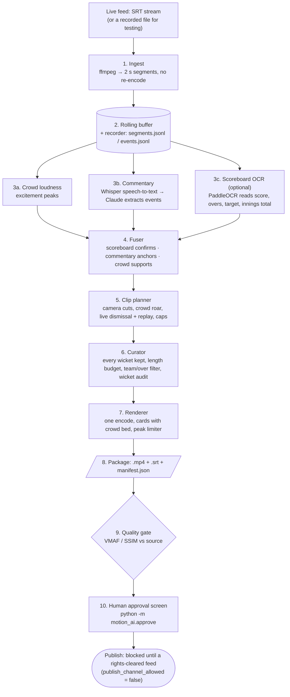

# Motion-ai — IPL live highlights (toss → end of powerplay, or the full match)

Turns a live cricket video feed into a ready-to-review highlights video, with no data feed: everything is read
from the broadcast itself (picture, commentary, crowd).

## How it works



### Steps, and why each one exists

1. **Ingest (SRT → 2-second segments).** ffmpeg copies the stream into short `.ts` files without re-encoding.
   *Why:* clips can be cut while the match is still live, the picture is never degraded before the single
   final encode, and a dropped feed reconnects on its own (stall watchdog) without losing what was recorded.
2. **Buffer + recorder.** Segments and every detected event are written to `runtime*/`.
   *Why:* a crash or restart resumes instead of starting over, and rules can be changed and re-checked in
   seconds with `python -m motion_ai.replay --plan-only` instead of re-processing the whole match.
3. **Three independent detectors read the same segments in parallel.**
   - *Crowd loudness* finds roars. *Why:* cheap, instant, and marks the exact second something happened.
   - *Commentary*: Whisper turns speech into text, Claude turns the text into events (wicket, six, review…);
     keyword rules are the fallback. *Why:* commentators name what happened, including run-outs and reviews
     that the scoreboard alone cannot explain.
   - *Scoreboard OCR* (optional, `OCR_AVAILABLE=true`): reads runs/wickets/overs, the chase target and the
     innings total. *Why:* the scoreboard is the ground truth: it confirms wickets and boundaries, detects
     the second innings and the result, and never mishears.
4. **Fuser.** Combines the three: the scoreboard confirms, commentary anchors the moment, crowd noise supports.
   Events are only finalised after the slowest detector has caught up. *Why:* each source alone is wrong
   sometimes (commentary talks over replays; the scoreboard updates late); together they are reliable.
5. **Clip planner.** Picks each clip's start on a camera cut, ends it when the crowd settles, keeps the live
   dismissal plus its replay, and skips known bad stretches (e.g. pop-ups). *Why:* clips that start mid-shot
   or end mid-celebration look automated; broadcast editors cut on cuts.
6. **Curator.** Keeps every wicket and the winning runs, fills the remaining time with sixes then fours,
   honours `HIGHLIGHT_OVERS` (chosen overs per team), and audits wickets against the scoreboard.
   *Why:* a highlights package that misses a wicket is wrong; length must stay inside the target.
7. **Renderer.** One H.264 encode at near-source quality, title / innings / break / result cards with a crowd
   bed, true-peak audio limiter. *Why:* one encode = no generation loss; cards give the story; the limiter
   keeps audio broadcast-safe.
8. **Package.** `.mp4` + `.srt` + `manifest.json` (every clip, why it was chosen or held, token cost).
   *Why:* the manifest is the audit trail a human (or a CMS) checks before anything goes out.
9. **Quality gate.** Every clip is compared with the source (VMAF ≥ 95, SSIM ≥ 0.985, 1080p, bitrate ≥ source).
   *Why:* "no quality loss" is measured, not assumed; one failing clip holds the whole package.
10. **Human approval.** Doubtful clips are held, never dropped; a person approves on a local page.
    *Why:* automation drafts, an editor decides; nothing is published automatically.

## Demo

**Note:** Some clip may appear unavailable due to limited AI resource availability within the allocated time, because of Claude's 5-hour usage limit and weekly usage limit.

| | Link |
|---|---|
| Source video (YouTube, used as a stand-in for the live SRT feed) | https://www.youtube.com/watch?v=F62YNMNfvA4 |
| Output highlights video (5:16, 1080p, latest: first ball of each innings, 16 clips + 6 cards) | https://wpz5sl5dmq.ufs.sh/f/mY3PNsje3CtyVigat0E0ufgwkM1JhiBF3lQjrzNmZ5Y6d2WX |
|
| All single clips (24 clips, 1080p, 299 MB; 16 used in the latest video) | see [Clips](#clips-all-rendered-clips-hosted-on-uploadthing) below |

Demo result (run `match_highlights_20261123_020437`, `HIGHLIGHT_SCOPE=match`):

| | Result |
|---|---|
| Clips | 16 |
| Cards | 6 |
| Wickets clipped | all 12 (7 + 5) |
| Quality gate | 16/16 pass, lowest clip VMAF 99.06 |
| Video length | 5:16 |

### Clips (all rendered clips, hosted on UploadThing)

| Clip | Innings | Event | Score at the event | Source time | Length | Used in the latest package |
|---|---|---|---|---|---|---|
| [000050_innings_start_b94cd16cf83e.mp4](https://wpz5sl5dmq.ufs.sh/f/mY3PNsje3CtySOy4uOWjrVhTieHRfCQABlK7bz9G85gDaWF3) | 1 | First ball | 2/0 | 0:50.1 | 6.51 s | In package at 0:05.0 |
| [000056_four_7ba325abad23.mp4](https://wpz5sl5dmq.ufs.sh/f/mY3PNsje3CtyR8XfhbIm50g1tUPwTCLBhWmFekJX4sO9aruq) | 1 | Four | 6/0 | 0:56.8 | 11.81 s | Not in package (budget) |
| [000070_wicket_e6a98e1e9670.mp4](https://wpz5sl5dmq.ufs.sh/f/mY3PNsje3Cty5LFaayG0qDNPOvxUH7zZcbGFMCj3AVJhgTYd) | 1 | Wicket | 6/1 | 1:10.5 | 24.9 s | In package at 0:11.5 |
| [000130_milestone_f01dccd7ee12.mp4](https://wpz5sl5dmq.ufs.sh/f/mY3PNsje3CtympKm8xje3CtyN6RscG1JuMXdAThYSjvPof4a) | 1 | Milestone | – | 2:10.6 | 12.0 s | Not in package (budget) |
| [000157_wicket_665b6849ae34.mp4](https://wpz5sl5dmq.ufs.sh/f/mY3PNsje3Cty4wU8MBlCapTFMSDbsocAxmWZKu51Y2Nl6w0y) | 1 | Wicket | 94/2 | 2:37.5 | 24.0 s | In package at 0:36.4 |
| [000177_four_1bc2e72095a7.mp4](https://wpz5sl5dmq.ufs.sh/f/mY3PNsje3Ctyo2hcptrwEhPaBHi409sX1WG2u876tDApSdMT) | 1 | Four | 99/2 | 2:57.6 | 12.9 s | Not in package (overlap) |
| [000195_wicket_7bcc8ea5e269.mp4](https://wpz5sl5dmq.ufs.sh/f/mY3PNsje3Ctyzj0ULkM6hVU02wpm3vPc4OEKXrfyWSkNiIZJ) | 1 | Wicket | 99/3 | 3:15.0 | 22.4 s | In package at 1:00.4 |
| [000281_wicket_dcc61f320595.mp4](https://wpz5sl5dmq.ufs.sh/f/mY3PNsje3CtynRzKu1DcEGi2yI8jbWdr4PLxMTaO169Vo0sl) | 1 | Wicket | 139/4 | 4:41.2 | 20.92 s | In package at 1:22.8 |
| [000295_four_cca6e2a85409.mp4](https://wpz5sl5dmq.ufs.sh/f/mY3PNsje3Ctyh5LpdHzwhlS8jUpH71JuNabRO3oYZKkAIms5) | 1 | Four | 161/4 | 4:55.6 | 12.42 s | Not in package (budget) |
| [000313_wicket_033f336c5d1d.mp4](https://wpz5sl5dmq.ufs.sh/f/mY3PNsje3Cty3L41vy6pEPiKquFrebansfv1WDJS59lXg67V) | 1 | Wicket | 177/5 | 5:13.8 | 23.74 s | In package at 1:43.7 |
| [000356_wicket_40a396d02772.mp4](https://wpz5sl5dmq.ufs.sh/f/mY3PNsje3CtyKRBRNbIx0pfYynNH5MZCa3hXlo7gjAb84kwJ) | 1 | Wicket | 179/6 | 5:56.1 | 18.24 s | In package at 2:07.5 |
| [000394_wicket_7420cfeb3fc5.mp4](https://wpz5sl5dmq.ufs.sh/f/mY3PNsje3CtyzOe77IM6hVU02wpm3vPc4OEKXrfyWSkNiIZJ) | 1 | Wicket | 179/7 | 6:34.2 | 13.46 s | In package at 2:25.7 |
| [000397_milestone_179f5c47c22b.mp4](https://wpz5sl5dmq.ufs.sh/f/mY3PNsje3CtydzsKMm3aOyJnqYKX73Qc8u1RiUNMrhCtvPVg) | 1 | Milestone | – | 6:38.0 | 12.0 s | Not in package (budget) |
| [000412_innings_start_a2f168dddb82.mp4](https://wpz5sl5dmq.ufs.sh/f/mY3PNsje3Ctyyg0TDwH1Jd6lVOQWf7gPexm1UvoH9Tpwa8rI) | 2 | First ball | 31/0 | 6:52.7 | 11.5 s | In package at 2:44.2 |
| [000444_wicket_f179681da5cb.mp4](https://wpz5sl5dmq.ufs.sh/f/mY3PNsje3CtyEJU5JW7ZIavgl6TwpXzbWyDFKem9C8o74tUj) | 2 | Wicket | 31/1 | 7:24.7 | 25.0 s | In package at 2:55.7 |
| [000463_four_74086fc13e75.mp4](https://wpz5sl5dmq.ufs.sh/f/mY3PNsje3CtyrkATntQGJteS8raj5D27sMRH6ngWIC3vZzpx) | 2 | Four | 73/1 | 7:43.8 | 8.78 s | Not in package (budget) |
| [000493_wicket_b0469f9a0ac6.mp4](https://wpz5sl5dmq.ufs.sh/f/mY3PNsje3Cty90r2vbK2RTAI0rzy7tLUDpdY38u6jBOSENko) | 2 | Wicket | 104/2 | 8:13.4 | 20.8 s | In package at 3:20.7 |
| [000507_wicket_3ae92fd8a7b1.mp4](https://wpz5sl5dmq.ufs.sh/f/mY3PNsje3CtypT4BFpdjIXq7xtJKiBkbU298L4yEwu1gCo6F) | 2 | Wicket | 112/3 | 8:27.1 | 25.0 s | In package at 3:41.5 |
| [000543_wicket_38b8dd833042.mp4](https://wpz5sl5dmq.ufs.sh/f/mY3PNsje3CtyRaWzBlm50g1tUPwTCLBhWmFekJX4sO9aruqb) | 2 | Wicket | 127/4 | 9:03.6 | 25.0 s | In package at 4:06.5 |
| [000575_wicket_2c8fe17b6423.mp4](https://wpz5sl5dmq.ufs.sh/f/mY3PNsje3CtybjcOybwz4EyOW1x6YaJ2kfbBecd8AGj5lUTV) | 2 | Wicket | 155/5 | 9:35.6 | 18.96 s | In package at 4:31.5 |
| [000579_four_d1352d85f6ad.mp4](https://wpz5sl5dmq.ufs.sh/f/mY3PNsje3Cty0MXL8pPhzA6e8toFWvBqMnfZlUKPCYdXHkmh) | 2 | Four | – | 9:39.6 | 10.0 s | Not in package (not on scoreboard) |
| [000584_six_e41b40ee4831.mp4](https://wpz5sl5dmq.ufs.sh/f/mY3PNsje3CtyVNFcF7NE0ufgwkM1JhiBF3lQjrzNmZ5Y6d2W) | 2 | Six | 177/5 | 9:44.6 | 7.96 s | In package at 4:50.4 |
| [000602_four_061f13df0617.mp4](https://wpz5sl5dmq.ufs.sh/f/mY3PNsje3Ctyp76849djIXq7xtJKiBkbU298L4yEwu1gCo6F) | 2 | Four | 181/5 | 10:02.8 | 12.97 s | Not in package (same ball as winning runs) |
| [000602_match_end_b0aca7fdfeee.mp4](https://wpz5sl5dmq.ufs.sh/f/mY3PNsje3Ctyv1w20Zt8pNqDyHbZcoLXwTr9mFh1SxW7jO5B) | 2 | Winning runs | 181/5 | 10:02.8 | 12.97 s | In package at 4:58.4 |

The source is a YouTube re-upload of a T20 Mumbai League broadcast: it is for internal demo only and must not be
published (`source_rights: unverified_youtube_reupload`).

## Sample output

One run produces three files with the same name in `output/` (`match_highlights_<YYYYMMDD_HHMMSS>.*`). The files
from a full-match run (`HIGHLIGHT_SCOPE=match`) of the demo source:

| File | What it is |
|---|---|
| `match_highlights_20261123_020437.mp4` | **The highlights video.** 5:16, 1920×1080 H.264 + AAC, 242 MB. Six cards (title, innings 1, innings break, innings 2, result, outro) and 16 clips: 12 wickets, 1 six, 2 innings starts and the match end. Not in the repo (too large for GitHub), see [Demo](#demo). |
| [`match_highlights_20261123_020437.json`](docs/sample_output/match_highlights_20261123_020437.json) | **The package manifest**, used by the approval page and the quality gate. It has the review status and deadline (`status`, `approve_by`, `on_timeout`), each clip (`clips[]`: where it sits in the package, type, caption, score and overs, confidence, hold reasons, source segments), each card (`cards[]`), the clips held back and why (`withheld[]`), a wicket audit per innings (wickets on the scoreboard vs wickets clipped: 7/7 and 5/5 here), match facts (innings scores, target), source and encoder details, rights (`source_rights`, `publish_channel_allowed`) and LLM token usage. |
| [`match_highlights_20261123_020437.srt`](docs/sample_output/match_highlights_20261123_020437.srt) | **The captions** as a sidecar subtitle file: 16 short cues timed to the package (`FIRST BALL`, `RUN OUT · DIRECT HIT`, `WICKET`, …). Players can show them as subtitles; they are not burned into the video by default. |

The single clips are not in `output/`. They are cut during the match into the clips folder of the runtime directory
(`runtime_1080/clips/` for this run), one `<match_time>_<type>_<id>.mp4` per clip with a `.json` of its details next to
it, e.g. `000070_wicket_e6a98e1e9670.mp4`. The manifest's `clips[].clip_file` names the file each clip in the package
came from. The folder also keeps the candidate clips the curator did not pick (24 cut, 16 used here). All 24 clips
are linked in the [Demo](#demo) table.

The runtime directory also holds the rest of the run's working files: `segments/` (the recorded source in short
`.ts` chunks, which clips are cut from), `cards/` (rendered title / innings / result cards), `events*.jsonl` (detected
events from the scoreboard OCR and the commentary, before and after fusing) and `cuts.json` (detected camera cuts).
The repo has this run's [`runtime_1080/`](runtime_1080/) with the data files only (events, cuts, segment list, each
clip's `.json`); the video files (`.mp4` clips and cards, `.ts` segments) are left out because of the source rights.

## Overview

Takes a live **SRT** feed and builds a highlights package automatically when the powerplay ends
(`HIGHLIGHT_SCOPE=powerplay`, default) or when the input ends (`HIGHLIGHT_SCOPE=match`: both innings, with
title / innings / break / result cards).
Clips are cut **during** the match, so at powerplay end only curation + joining remains.

## Architecture

```
SRT ─► ingest (2s segments) ─► buffer ─┬─► crowd/loudness excitement ──┐
                                       ├─► commentary: Whisper + Claude ┼─► fuser ─► clip per event
                                       └─► scoreboard OCR  (optional) ──┘              │
                                                                         powerplay end ▼
                                                     Claude curator ─► renderer ─► output/*.mp4 + .srt + .json
```

| Folder | What it does |
|---|---|
| `motion_ai/ingest/` | SRT → timestamped segments; auto-reconnect; rolling buffer |
| `motion_ai/detectors/` | Independent signal sources. **`__init__.py` is the only place that reads `OCR_AVAILABLE`** |
| `motion_ai/fusion/` | Combines sources into final events (rules differ for OCR on/off — see `fuser.py` docstring) |
| `motion_ai/highlights/` | Clip cutting, Claude curation (with rule-based fallback), rendering, powerplay trigger |

## OCR is optional

| `OCR_AVAILABLE` | Event sources | Notes |
|---|---|---|
| `false` (default) | Commentary (Whisper + Claude) + crowd audio | No OCR packages needed. Powerplay end from commentary, manual trigger or safety timer |
| `true` | + scoreboard OCR as the source of truth for runs/wickets/overs | Needs `config/scoreboard.json` and `pip install -r requirements-ocr.txt`. Fails at startup with a clear message if missing |

## Run

```bash
pip install -r requirements.txt          # + requirements-ocr.txt if OCR_AVAILABLE=true
cp .env.example .env                     # set SRT_URL, ANTHROPIC_API_KEY, OCR_AVAILABLE
cp config/match.example.json config/match.json   # teams + players for this match
python -m motion_ai
```

Requires `ffmpeg` built with SRT support on PATH, and an NVIDIA GPU for Whisper (or `ASR_DEVICE=cpu`).

**Manual powerplay trigger** (any time): `touch runtime/TRIGGER_POWERPLAY_END`

## Full match (`HIGHLIGHT_SCOPE=match`)

* Powerplay end is only logged; every clip of both innings is kept for curation; the package is built at end of input.
* 2nd innings = scoreboard drops >= 30 runs and >= 30 balls after >= 10 overs, held 6 reads / 3 s (a highlights
  video joins the chase mid-over, e.g. 31/0 in 2.4). `TARGET - n` is read from its own OCR region.
* Budget (`HIGHLIGHT_TARGET_SECONDS`, cards included, hard max 360 s): every wicket and the winning runs are always in;
  the rest is split 50/50 by innings (sixes, then fours from the last over back). Every dropped clip is listed in
  the manifest `withheld[]` with its reason.
* Needs `OCR_AVAILABLE=true`: only scoreboard-confirmed boundaries/wickets are shown, so startup fails without OCR.
* Cards show a number only from a confirmed read; `wicket_audit` compares wickets on the scoreboard with wickets
  clipped per innings, and any shortfall holds the package (`wicket_missing`, naming each score not clipped).
  A confirmed end-of-innings read (`innings_end`, e.g. 179/7) is authoritative for `wickets_on_board`, so a
  last-ball wicket that never showed as a score change is still named ("innings 1: 179/7 (20.0 ov) not clipped").

## Selected overs (`HIGHLIGHT_OVERS`)

Only some overs of each batting team, in both scopes. Empty/unset = every over.

```bash
HIGHLIGHT_OVERS=[{"team":"Triumph Knights","overs":"1-6"},{"team":"Eagle Thane Strikers","overs":[1,2,"16-20"]}]
```

* `overs`: an `"a-b"` range, a list of overs, or a mix (`["1-6", 20]`), each 1..20. A team not listed keeps all overs.
* Team names are checked against `config/match.json` `teams` at startup (unknown name = clear error). Innings 1 is
  batted by `"batting_first"` (add it to match.json, e.g. `"batting_first": "Triumph Knights"`; if missing, the
  first team key is used and a warning is logged), innings 2 by the other team.
* Over of a ball = from the scoreboard `o.b` at the ball (`event_overs`, else `overs`): `o.b` with b > 0 is over
  o+1 (`0.1` -> 1, `5.6` -> 6), `o.0` is over o (`6.0` -> 6, the ball that completed it). A commentary-only clip
  takes the next ball after the last board reading. Toss and innings-start clips are never filtered.
* Clips outside the selection go to `withheld[]` with reason `not_selected_over`; wickets outside it are listed in
  `wicket_audit.innings_N.not_selected_over` and never count as missing.
* Cards carry a soft crowd bed from the match's own feed (no dead air): back-to-back cards share one stretch taken
  right after the previous clip (the reaction), or just before the first clip for the opening cards; band-limited
  to 80-400 Hz so commentary is only a murmur, normalised to -27 LUFS (~-31 dB mean vs ~-23 dB for clips on the
  demo match, i.e. ~8 dB under the programme), 0.4 s fades.
* Every clip and card goes through a true-peak limiter (4x oversampled `alimiter`, ceiling -2 dBFS, no auto-gain,
  delay-compensated) in the same single encode: the package stays <= -1 dBTP after AAC, programme loudness
  unchanged, same codec / rate / channels so the `-c copy` join still works.
  Manifest `cards[].crowd_bed_t` = stream time used; no source audio -> silent card + a warning.

## Output quality

One encode only (ingest is `-c copy`): no upscale (a 1080p source is not scaled at all), source frame rate,
`libx264 -preset slow -crf 17 -profile:v high`, AAC 192k at the source rate. After rendering, a **binding quality
gate** compares every clip (before its caption) with the original source: VMAF mean >= 95, 5th percentile >= 90,
SSIM >= 0.985, plus 1080p / fps / High profile / bitrate >= source. One failure holds the package; the table is
in the manifest (`quality_gate`). Re-run it with `python -m motion_ai.quality output/<package>.json`.

**Iterate without re-processing** — every run records `runtime/events.jsonl` + `runtime/segments.jsonl`:

```bash
python -m motion_ai.replay --plan-only   # re-fuse + clip plans as JSON (~1s)
python -m motion_ai.replay               # re-render the package from cached segments
python -m motion_ai.rebuild              # re-curate already-rendered clips (no encoding)
python -m motion_ai.redetect ocr         # re-run one detector (ocr | commentary | audio) on the recorded segments
python -m motion_ai.redetect ocr --apply # ...and swap its events into events.jsonl
```

**Publishing safety** — the manifest carries `status` (`auto_ok` / `hold_for_review`), per-clip
`hold_reasons` (run_out, review, asr_only, no_call_anchor, no_cut_snap, slow_confirm, ocr_low_conf,
over_cap), `approve_by`, `on_timeout_result` and `publish_channel_allowed: false` (until the IPL
template and approve step exist). Held clips are never dropped and never auto-published.

## Branding template

Card and caption styling (colours, font, font sizes, logo, card lengths, caption box/position, safe margins)
comes from `config/template.json` if it exists, else from `config/template.example.json` — a neutral
placeholder equal to the built-in defaults. Every key is optional; a missing key keeps the default.
The template is validated at load (bad colour, unknown key, missing font/logo file -> a clear `TemplateError`).
Caption *text* is not part of the template, only its styling.

To brand the package, copy the example to `config/template.json` (git-ignored) and drop in the licensed files,
e.g. under `config/brand/` (relative paths are resolved against `config/`):

| File | Key | Notes |
|---|---|---|
| Logo, PNG with alpha (transparent background) | `logo.file` | Shown on every card (`logo.card`: position / width px / opacity); optional small corner bug on clips via `logo.clip_bug.enabled` |
| Font, `.ttf` or `.otf` | `font.file` | `null` = DejaVu Sans Bold; sizes per role in `font.sizes` (`headline`, `subhead`, `stat`, `body`, `small`, `caption`) |
| Colours | `colors.*` | `#rrggbb` or `#rrggbbaa` (or a basic name like `white`): `background`, `accent` (card bar, drawn when `cards.accent_bar_height` > 0), `text`, `caption_text`, `caption_border`, `caption_box` |

Other keys: `cards.seconds` (per card), `cards.line_spacing`, `cards.fade`, `caption.y` (top of the caption text
as a fraction of frame height; <= 0.75 so it never covers the broadcaster score bar), `caption.border_width`,
`caption.box` / `caption.box_padding` (top/bottom px) / `caption.box_padding_x` (left/right px), `caption.fade`
(s, fade in at the caption start and out at the clip end), `caption.ref_height` (the caption px values are for this
frame height and scale with the output), `safe_margins.x/y` (px, logo inset).
The default caption is a solid brand box (navy text on the gold accent, 88 px at 1080p) top centre at y 0.15,
clear of the broadcaster score bar (y 900-1024) and the corner logos, so it reads as ours, not the broadcaster's.
Positions: `top-left`, `top-right`, `bottom-left`, `bottom-right`, `top-center`, `bottom-center`.
Note: the curator still budgets the package with its own card lengths (`CARD_SECONDS`), so keep
`cards.seconds` close to them.

## Approval

```bash
python -m motion_ai.approve output/<package>.json [--port 8765] [--clips-dir runtime_1080/clips]
# then open http://127.0.0.1:8765/
```

A local review page (stdlib only, bound to 127.0.0.1) shows the package summary (status, holds,
quality gate, wicket audit, time left until `approve_by`), every clip with a video player, caption,
score/overs, sources and hold reasons, and the withheld clips (read-only). Enter your reviewer name,
then Approve / Reject each clip (optional note) and the package.

- Decisions go to `<package>.approvals.json` next to the manifest (who, when, decision, note per
  clip and for the package, plus an append-only history). The manifest is never modified.
- The package counts as approved only when the reviewer approved it, every held clip has a
  decision, and every hard-blocker hold (`quality_gate_failed`, `wicket_missing`) is named in the
  package note. The result (approved / rejected / auto-included clip ids, blockers) is stored as
  `publish_decision` in the approvals file (`motion_ai.approve.compute_publish_decision`).
- `publish_channel_allowed` stays false: this step only records approval; publishing is separate.
- Only files the manifest references are served (package mp4 and each clip's `clip_file`, looked
  up by clip id). If a clip file is missing, the page plays that clip's span of the package mp4.

## Tests

```bash
pytest tests
```

## Scoreboard calibration

OCR runs in its own venv (PaddleOCR 2.x needs numpy<2; the main `.venv` stays on numpy 2.x):

```bash
uv venv --python 3.10 .venv-ocr
uv pip install --python .venv-ocr/bin/python -r requirements-ocr.txt   # ffmpeg must be on PATH
```

`config/scoreboard.json` holds pixel boxes for one broadcaster's graphics. For a new broadcaster / video,
propose them automatically:

```bash
.venv-ocr/bin/python -m motion_ai.calibrate path/to/match.mp4                    # 5 middle frames (9, 17 if needed)
.venv-ocr/bin/python -m motion_ai.calibrate path/to/match.mp4 --at 100 470 400   # frames you picked
#   --out config/scoreboard.proposed.json (default)  --gpu  --preview-dir runtime/calibration
```

It runs PaddleOCR detection over the bottom 25% of each frame (native resolution), finds the score bar
(`73-1` + overs, merged across neighbouring boxes; the most-seen, tallest-text cluster wins over e.g. bowler
figures), `TARGET n` next to it, the `OVERS x TOTAL r-w` card footer and a second score-bar position
(`scoreline_alt`), pads the union of the boxes seen across frames, and writes them in the
`config/scoreboard.json` format. `scoreline` must be seen on >= 2 frames; `target` / `footer` on >= 1.

Then:

1. Look at `runtime/calibration/<video>/` — `frame_*.png` (all OCR boxes grey, proposed regions coloured) and
   `region_*.png` (each crop as the detector sees it).
2. Check the printed validation table (each region re-read with `ScoreboardOCRDetector` on every frame).
3. `target` only shows in the chase and `footer` only on the scorecards after an innings: if they are missing,
   re-run with `--at` times where they are on screen (also add a few score-bar times).
4. Copy the proposal to `config/scoreboard.json` (edit boxes by hand if a preview is off).
